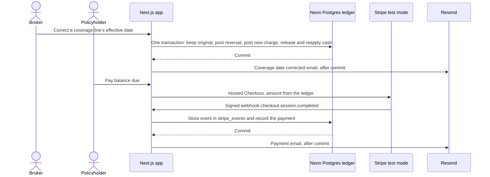
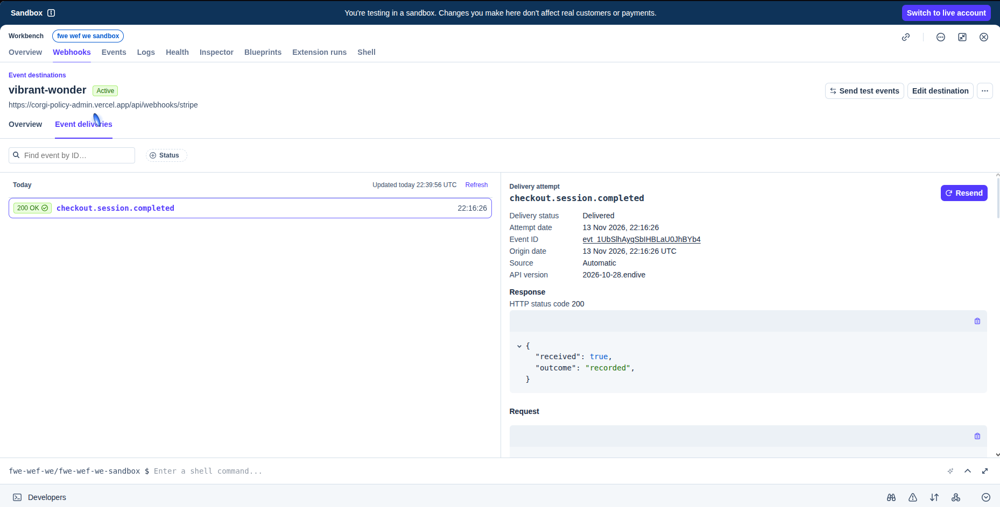
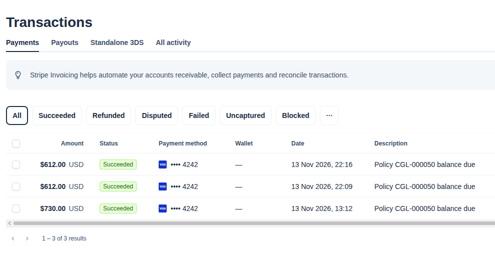
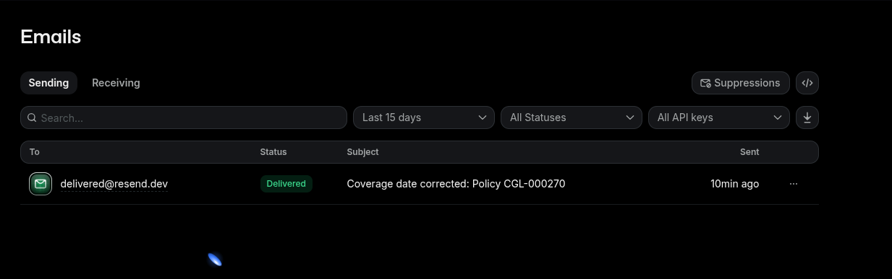

# Policy Admin (Track 1: commercial general liability)

A small policy administration app where every change to a charge or payment lands on an append-only ledger, and date corrections are reverse-and-rebook.

**Track 1** · **Live:** https://corgi-policy-admin.vercel.app

[Live app](https://corgi-policy-admin.vercel.app) · [Demo video](https://youtu.be/FHR2yN2rdQQ?si=9XHc7Gpkg2YzWqN9) · [Evidence](docs/evidence/) · [Decision log](DECISIONS.md) · [Debrief](DEBRIEF.md)

## Contents
- [What it is](#what-it-is)
- [Demo logins](#demo-logins)
- [Roles](#roles)
- [How it flows](#how-it-flows)
- [How the ledger math works](#how-the-ledger-math-works)
- [Sandbox integrations](#sandbox-integrations)
- [Infrastructure](#infrastructure)
- [Stack](#stack)
- [Run locally](#run-locally)
- [Tests](#tests)
- [Sandbox evidence](#sandbox-evidence)
- [Decisions and assumptions](#decisions-and-assumptions)

## What it is
A small policy administration app for one product, commercial general liability (CGL).
A broker creates customers, issues 12-month policies, adds coverage lines and corrects a
coverage line's effective date, and every change to a charge or payment lands on an
append-only ledger. The policyholder signs in to see their statement and timeline and pays
the balance due through Stripe Checkout in test mode.

**Live app:** https://corgi-policy-admin.vercel.app

## Demo logins
These are demo accounts in a Clerk development instance (it shows a "Development mode" badge),
and all payments are Stripe test mode. Nothing here is a real payment or a real customer.

| Role | Email | Password |
|---|---|---|
| Broker | broker@example.com | CorgiBroker-2026! |
| Policyholder | delivered@resend.dev | CorgiHolder-2026! |

To pay as the policyholder, use Stripe's test card `4242 4242 4242 4242`, any future expiry
and any CVC.

## Roles
**Broker** (`/broker`), sees only their own customers and policies:
- create a customer profile
- issue a policy (term start, limit, rate in basis points, transaction date) with a review step
- add a named coverage line to an active policy, with a review step
- correct a coverage line's effective date (new date, transaction date, required reason)
- view each policy's statement, timeline, coverage lines and charge calculations

**Policyholder** (`/portal`), sees only their own policies:
- view the statement, timeline and coverage lines
- pay the whole balance due with Stripe Checkout (the amount comes from the ledger on the
  server, never from the form)

Roles come from Clerk `publicMetadata.role`, and each login must also be linked to a broker or
customer row in the database. Every page and server action checks both on the server.

## How it flows

## How the ledger math works
- **Integer cents everywhere.** Premium = limit x rate_bps / 10000. A charge is prorated as
  round_half_up(premium x days_in_effect / days_in_term), rounded once per entry. A daily rate
  is never computed.
- **Append-only ledger.** Charges, reversals, payments and allocations are only ever inserted.
  Database triggers reject UPDATE, DELETE and TRUNCATE on the audit tables. The sum of the
  entries is the balance.
- **Reverse-and-rebook corrections.** Correcting a date never edits the original charge. A
  reversal negates it exactly and a new charge is computed at the corrected date.
- **FIFO payment allocation.** Cash pays the oldest open charge first. When a reversal frees
  cash that had paid the old charge, the cash is released and applied again, oldest charge
  first.

### Example: correcting $612 to $626
A $730.00 line (term 2026-01-01 to 2027-01-01, 365 days) was entered effective 2026-03-01
and paid. The real start was 2026-02-22.

| Ledger entry | Days | Amount |
|---|---|---|
| Original charge, effective 2026-03-01 (stays as it was) | 306 / 365 | $612.00 |
| Reversal of the original | | -$612.00 |
| New charge, effective 2026-02-22 | 313 / 365 | $626.00 |
| Payment already made | | -$612.00 |
| **Balance due** | | **$14.00** |

[DEBRIEF.md](DEBRIEF.md) walks through a correction after payment with real numbers.

## Sandbox integrations
- **Stripe (test mode):** the policyholder pays through hosted Checkout. Only the signed webhook
  at `/api/webhooks/stripe` (event `checkout.session.completed`) records a payment. Each event
  is stored in `stripe_events` with its outcome, so a retried delivery is a no-op. Live keys
  are refused.
- **Resend:** one plain-text email to the customer when a payment is recorded and one when a
  coverage date is corrected. Emails are sent only after the database transaction commits, a
  send failure never undoes the payment or correction, and every attempt (sent, skipped or
  failed) is kept in `email_log`, at most one per kind per event.

## Infrastructure
| Service | Role |
|---|---|
| **Clerk** | Sign-in and roles (development instance). |
| **Neon** | Postgres. Reads go over Neon HTTP; each write command runs in one transaction on a short-lived WebSocket pool. |
| **Vercel** | Hosting, Node runtime. |

## Stack
Next.js 16 (App Router, server actions), React 19, TypeScript, Drizzle ORM, Neon Postgres,
Clerk, Stripe, Resend (REST API over fetch), Tailwind CSS 4 with shadcn/ui primitives, Vitest.

## Run locally
Needs Node 24 and npm.

1. `npm install`
2. Copy `.env.example` to `.env.local` and fill in:
   `APP_URL` (optional), `DATABASE_URL`, `NEXT_PUBLIC_CLERK_PUBLISHABLE_KEY`,
   `CLERK_SECRET_KEY`, `STRIPE_SECRET_KEY` (test key), `STRIPE_WEBHOOK_SECRET`,
   `RESEND_API_KEY` (optional), `RESEND_ALLOWED_TO` (optional).
3. `npm run db:migrate`, then `npm run db:seed` (one broker and one customer).
4. In Clerk, create two users with `publicMetadata.role` set to `broker` and `policyholder`,
   and add `metadata` (the user's public metadata) to the session token. Then link them:
   `npm run db:link -- --broker user_... --policyholder user_...`
5. `npm run dev`, and in another terminal forward Stripe test webhooks:
   `stripe listen --forward-to localhost:3000/api/webhooks/stripe`
   (put the `whsec_...` secret it prints in `STRIPE_WEBHOOK_SECRET`).

## Tests
| Command | What it runs |
|---|---|
| `npm run test` | Unit and component tests (no network, no database). |
| `npm run db:check` | Integration tests against the real database. Every test runs in a transaction that is rolled back. |
| `npm run check` | Design check, typecheck, lint, unit tests and production build. |

## Sandbox evidence
Screenshots of the deployed app, Stripe test payments and Resend emails are in
[docs/evidence/](docs/evidence/).

**Stripe webhook delivery**

**Stripe test payment**

**Resend email delivered**

## Decisions and assumptions
- [DECISIONS.md](DECISIONS.md): the dated decision log, one line of reasoning per decision.
- [ASSUMPTIONS.md](ASSUMPTIONS.md): pricing and business rules, and what was cut for time.
- [DEBRIEF.md](DEBRIEF.md): the Track 1 correction scenario, step by step.
